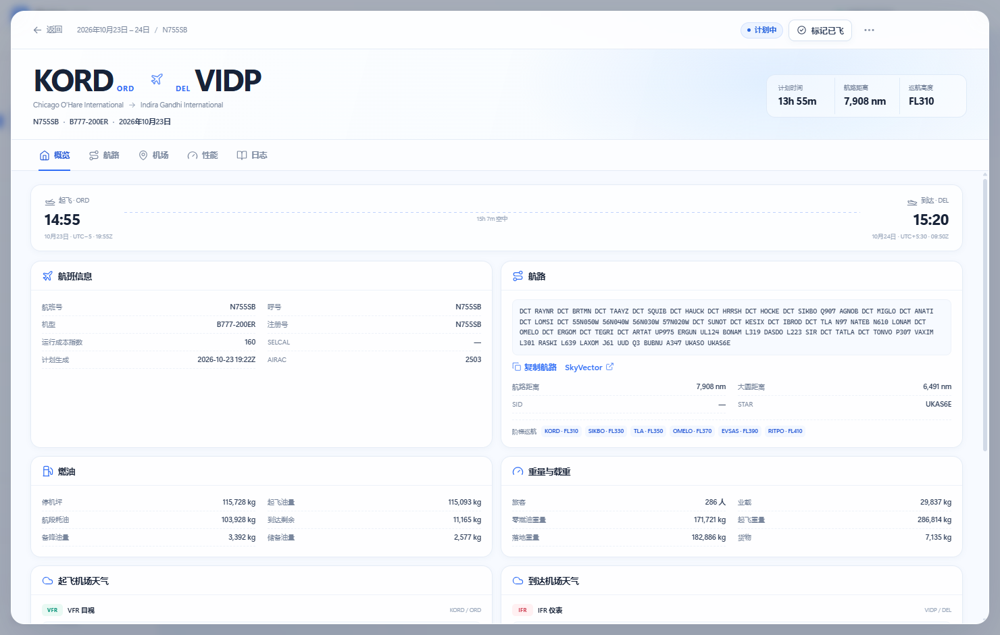

# SkyLog 航迹

> 把每一次起飞，都留在地图上。

SkyLog 航迹是一款面向微软模拟飞行玩家的 Windows 桌面飞行计划与飞行日志工具。它从 SimBrief 读取 OFP，把航班号、起降机场、巡航高度、航路、机型和性能数据整理成可回看的记录，并在内置世界地图上画出完整航迹。

模拟飞行玩家通常在 SimBrief 生成计划，但计划容易散落在网页、PDF 和截图里；同一次游戏里的多个起降也不容易归档。SkyLog 想解决三件事：**计划读得进来、航线看得清楚、飞行记得下来。**

## 界面

## 功能

### 读取 SimBrief

- 输入 Pilot ID，或粘贴 SimBrief 计划链接，读取最新一份 OFP。
- 自动识别航班号 / 呼号、起降机场、计划时间、机型与注册号。
- 读取巡航高度、阶梯巡航、航路、航路点、燃油、载重、天气、性能数据和机组信息。
- 自动检查重复计划；同一份计划需要记录第二个架次时，可以确认后再次导入。
- 只调用 SimBrief 的公开读取接口，不保存账号密码。

### 世界地图

- 内置 Natural Earth 1:50m 世界矢量地图，浅色、干净，**不依赖在线瓦片**；只有读取 SimBrief 时需要联网。
- 航线支持两种显示方式：**航点连线** 或 **起降直连**。
- 机场标签可切换为全称、IATA/ICAO 代码，或代码加全称。
- 可显示 / 隐藏航点、备降场，也可以叠加全部已存航班。
- 点击航线、机场或航点，打开对应详情；支持缩放与一键适应航路。
- 航点模式会保留 SimBrief 计划里的真实航路走向，而不是简单的两点直线。

### 航段详情

每个航段都有完整详情页，分为：

- **概览**：航班信息、起降时间、巡航、航路、燃油、载重、机场天气、机组与计划链接。
- **航路**：逐点航路表，包含航点、航路、阶段、高度、距离、累计时间、剩余油量、风和 FIR。
- **机场**：起飞机场、到达机场和备降机场的跑道、海拔、时区、坐标、METAR / TAF。
- **性能**：起飞与着陆性能、V 速度、跑道距离、高度与成本指数影响、重量限制。
- **日志**：标记已飞、填写实际日期、实际轮挡和备注，也可以移动所属游戏会话。

### 飞行日志与游戏会话

- 一次游戏可以包含多个起降。导入时明确选择：**新的游戏会话** 或 **加入现有游戏**。
- 日志按游戏会话分组，显示航段数、已飞数量、总距离和总时间。
- 支持把航段移出为新的游戏、移动到其他游戏、合并两个游戏会话。
- 支持重命名游戏、写游戏备注、搜索、状态筛选和排序。
- 航段状态、实际执行日期、实际轮挡与个人备注都会保存在本地。

### 本地数据

- 所有日志、计划详情和原始 SimBrief JSON 都保存在本机，不上传云端。
- 支持导出 JSON 备份、CSV 飞行记录，以及单个航段的原始 JSON。
- 支持重量、距离、高度、时间显示单位和地图标签的偏好设置。
- 日志损坏时会自动尝试从备份恢复。

## 使用流程

1. 安装并打开 SkyLog 航迹。
2. 在「设置」里填入 SimBrief Pilot ID，或直接点「导入 SimBrief」。
3. 确认计划，选择它属于新的游戏还是已有游戏。
4. 导入后在地图上查看航路，点击机场或航线查看详情。
5. 飞行结束后，在航段日志里标记已飞并写下备注。

## 设计

界面采用浅色、低饱和的航空蓝配色，减少长时间查看数据的疲劳。航路绘制、面板切换和数字统计都带有适度动画；同时尊重系统的“减少动态效果”设置。

应用隐藏系统标题栏，使用与界面一体化的浅色顶栏，整体更像一张安静的电子飞行日志，而不是一个复杂的航空运行系统。

## 技术实现

- **桌面框架**：Electron 43（Windows x64）。
- **界面**：原生 JavaScript + CSS，Vite 构建；Leaflet 负责地图交互。
- **地图数据**：Natural Earth 1:50m 国家边界与轮廓，本地打包。
- **主进程**：负责 SimBrief 请求、数据归档、文件读写和本地日志存储。
- **数据层**：纯 JavaScript 计划归一化模块，将 SimBrief 原始 JSON 转换成稳定的应用数据模型。
- **测试**：Node.js 单元测试覆盖计划解析、地理计算、会话分组、备份恢复、CSV 与异常恢复。

## 兼容性与安装

- 支持 Windows 10 / 11 x64。
- 提供 NSIS 安装包，支持选择安装目录、创建桌面和开始菜单快捷方式。
- 安装包约 104 MB；应用本身不依赖外部地图服务。
- 卸载应用不会删除本地飞行日志。

## 测试状态

- 29 项单元测试全部通过。
- 使用真实 SimBrief 计划完成导入、地图显示、航段详情和日志流程测试。
- 已验证打包应用启动、安装包静默安装 / 卸载，以及安装后的实际导入流程。
- 主要流程未发现阻塞性问题。

## 说明

SkyLog 不是 SimBrief 或 Navigraph 的官方产品。飞行计划内容归 SimBrief / Navigraph 所有；地图轮廓来自 Natural Earth 公共领域数据。请遵守 SimBrief 的使用条款，不要高频批量读取计划。
