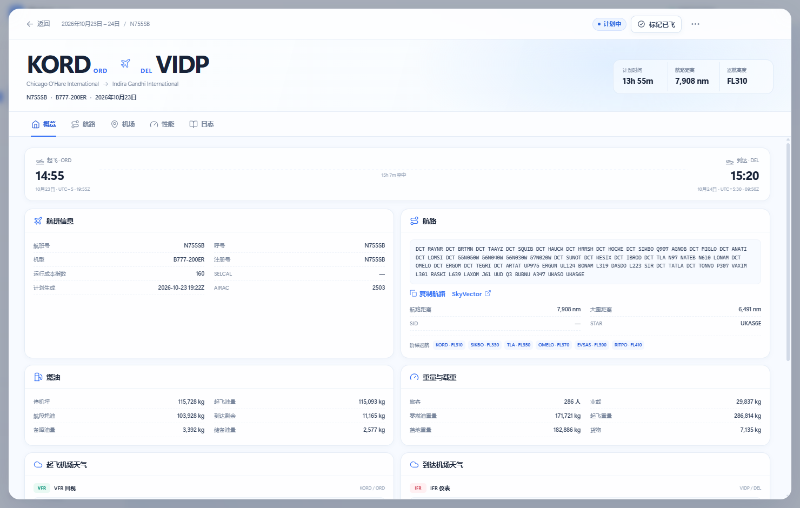

# SkyLog 航迹

> 把每一次起飞，都留在地图上。

SkyLog 航迹是一款面向微软模拟飞行与 X-Plane 玩家的桌面飞行计划与飞行日志工具。它从 SimBrief 读取 OFP，把航班号、起降机场、巡航高度、航路、机型和性能数据整理成可回看的记录，并在内置世界地图上画出完整航迹。v1.3.0 提供全新的深色航电 UI、可折叠侧栏、自动组件安装与游戏唤起、全宽遥测长条图，以及关闭到托盘、使用协议与免责声明。

模拟飞行玩家通常在 SimBrief 生成计划，但计划容易散落在网页、PDF 和截图里；同一次游戏里的多个起降也不容易归档。SkyLog 想解决三件事：**计划读得进来、航线看得清楚、飞行记得下来。**

## English overview

SkyLog is a local-first flight-plan and logbook app for Microsoft Flight Simulator and X-Plane. It reads your latest SimBrief OFP, draws the route and waypoints on an offline world map, and keeps every leg grouped into a game session. Version 1.3.0 adds a dark cockpit UI, hover-expanding icon rail, 150 ms page fades, automatic simulator component installation and launch, a full-width telemetry strip, tray close behaviour, and in-app terms/disclaimer.

## 界面

## 功能

### 读取 SimBrief

- 输入 Pilot ID，或粘贴 SimBrief 计划链接，读取最新一份 OFP。
- 自动识别航班号 / 呼号、起降机场、计划时间、机型与注册号。
- 读取巡航高度、阶梯巡航、航路、航路点、燃油、载重、天气、性能数据和机组信息。
- 自动检查重复计划；同一份计划需要记录第二个架次时，可以确认后再次导入。
- 只调用 SimBrief 的公开读取接口，不保存账号密码。

### 世界地图

- 内置 Natural Earth 1:50m 世界矢量地图，浅色、干净，**不依赖在线瓦片**；只有读取 SimBrief 时需要联网。
- 中国台湾、香港、澳门作为中国的一部分呈现；南海诸岛与九段线按中国标准地图标注。
- 航线支持两种显示方式：**航点连线** 或 **起降直连**。
- 机场标签可切换为全称、IATA/ICAO 代码，或代码加全称。
- 可显示 / 隐藏航点、备降场，也可以叠加全部已存航班。
- 点击航线、机场或航点，打开对应详情；支持缩放与一键适应航路。
- 航点模式会保留 SimBrief 计划里的真实航路走向，而不是简单的两点直线。

### 航段详情

每个航段都有完整详情页，分为：

- **概览**：航班信息、起降时间、巡航、航路、燃油、载重、机场天气、机组与计划链接。
- **航路**：逐点航路表，包含航点、航路、阶段、高度、距离、累计时间、剩余油量、风和 FIR。
- **机场**：起飞机场、到达机场和备降机场的跑道、海拔、时区、坐标、METAR / TAF。
- **性能**：起飞与着陆性能、V 速度、跑道距离、高度与成本指数影响、重量限制。
- **日志**：标记已飞、填写实际日期、实际轮挡和备注，也可以移动所属游戏会话。

### 飞行日志与游戏会话

- 一次游戏可以包含多个起降。导入时明确选择：**新的游戏会话** 或 **加入现有游戏**。
- 日志按游戏会话分组，显示航段数、已飞数量、总距离和总时间。
- 支持把航段移出为新的游戏、移动到其他游戏、合并两个游戏会话。
- 支持重命名游戏、写游戏备注、搜索、状态筛选和排序。
- 航段状态、实际执行日期、实际轮挡与个人备注都会保存在本地。

### 本地数据

- 所有日志、计划详情和原始 SimBrief JSON 都保存在本机，不上传云端。
- 支持导出 JSON 备份、CSV 飞行记录，以及单个航段的原始 JSON。
- 支持重量、距离、高度、时间显示单位和地图标签的偏好设置。
- 日志损坏时会自动尝试从备份恢复。

### 新首页与折叠侧栏（v1.3.0）

- 首页改为深色飞行工作台：左侧是游戏启动卡，右侧是历史航迹列表；**首页不显示地图**。
- 左侧菜单默认只显示图标（78px），鼠标移入后向右展开为文字导航（252px）。
- 页面切换改为 **150ms 淡入淡出**，不再使用圆形扩散转场。
- 首页保留历史航段的航班号、机型、起降机场、轮挡时间、距离与状态，可点击进入航段详情。

### 飞行数据遥测（v1.3.0）

- **微软模拟飞行 2020/2024**：通过 SimConnect 直接读取；应用启动时自动安装/修复组件，并在 MSFS 用户目录写入 `exe.xml`，模拟器启动时自动唤起 SkyLog。随后 SimConnect 自动连接并记录。
- **X-Plane 11/12**：优先使用 UDP RREF，默认端口 `49000`；如果安装 FlyWithLua，则会自动复制可启动 SkyLog 的桥接脚本。
- 地图下方新增 **全宽长条遥测图**：高度（青）、速度（琥珀）、航向（紫）分三条轨道显示，随采样实时更新；支持实时与已保存数据。
- 数据桥接只监听本机 `127.0.0.1:42831`，不会上传互联网。
- 设置 → 飞行数据连接可查看状态、重新检测和“安装 / 修复组件”。

### 关闭、托盘与协议（v1.3.0）

- 关闭窗口时弹窗选择 **直接退出** 或 **收进系统托盘**；勾选“保存我的选择”后以后不再询问。设置中可修改默认行为与询问开关。
- 首次启动阅读并同意 **《用户使用协议》** 与 **《免责声明》** 后才能进入；不同意会退出应用。两份文档可在设置中随时重读。
- 设置 → 我的赞赏码展示赞赏图片，并带“感谢分享 / 感谢开发 / 感谢每一次起飞”的横向流动文字。

### 下载中心（v1.2.0）

- 菜单栏新增「下载」：聚合 FlyByWire 直链、FlightSim.to、飞行宝与 X-Plane 插件资源，支持 MSFS 2020/2024、X-Plane 11/12 分类筛选。
- FlyByWire A32NX / A380X 使用官方 GitHub Release 直链；下载完成后可一键解压并安装到 Community。
- FlightSim.to 和飞行宝需要登录，应用会打开对应来源页，不绕过登录或抓取受保护内容。
- 下载任务支持 4 路 Range 多线程、断点临时文件合并、速度 / 剩余时间 / 进度显示；所有进行中的任务都会出现在右下角的圆形下载按钮里。
- 支持安装程序（`.exe`、`.msi`、`.dmg`、`.pkg`）直接打开；ZIP / 7Z 资源安装到已选择的社区目录。
- 工具箱新增 URL 下载：输入下载地址，自动识别文件名，保存目标路径会持久化。

### 首启与赞赏（v1.3.0）

- 首次启动先显示《用户使用协议》和《免责声明》；同意后才能进入，不同意会退出应用。
- 设置中可随时重读协议；标题栏保留「我已赞赏」入口。
- 设置 → 我的赞赏码展示支持二维码和流动的感谢文字；赞赏完全自愿，不影响任何功能。

### 转场与视觉（v1.3.0）

- 深色航电工作台、折叠图标栏、150ms 页面淡入淡出、地图底部全宽遥测长条图。
- 关闭窗口支持直接退出或收进系统托盘；首次关闭时弹窗询问，可保存选择。

### 游戏与启动（v1.1.1）

- 首页左侧按 X-Plane / Microsoft Flight Simulator 两个系列展示游戏，右侧为历史航迹；飞机图库已移除。
- 自动检测 X-Plane 11 / 12 与 Microsoft Flight Simulator 2020 / 2024；支持 Steam、Microsoft Store、常见安装目录与 macOS Applications 目录。
- 第一次启动会全盘搜索游戏本体，避免非默认目录漏检；随时可以重新全盘搜索或手动选择可执行文件 / `.app`。
- 大号启动按钮会显示当前游戏与 Steam / Store / 本地来源；macOS Steam 版 X-Plane 通过 Steam 启动，避免 `libsteam_api.dylib` 缺失崩溃。

### 工具箱与主题（v1.1.1）

- 菜单栏新增「工具箱」，提供 7 个航空公司主题：中国国际航空、中国南方航空、中国东方航空、深圳航空、海南航空、厦门航空、上海航空。
- 主题会改变应用主色、菜单栏图标与地图以外的背景图；使用 16 位兑换码解锁。
- 支持导入自定义背景图并调节不透明度（设置或工具箱），地图页面保持干净。
- 菜单栏切换页面时使用圆形扩散转场；主题是对公开配色的原创演绎，本应用无任何商业行为，如有侵权请联系删改。

### 地图航线

- 新增「全部航线高亮」：所有已存航线使用完整颜色和线宽显示，并自动适配全部航线视野。
- 航线支持两种显示方式：**航点连线** 或 **起降直连**。

### 创建 SimBrief（v1.1.0）

- 在应用内填写起降机场、机型、航司、航班号、日期时间、航路、备降场与旅客数。
- 一键打开 SimBrief 官方 dispatch 页面并预填参数；在 SimBrief 登录并生成 OFP 后，回到 SkyLog 读取最新计划即可导入日志。
- SimBrief 的正式创建 API 需要 Navigraph 合作方密钥，因此应用不保存密码，也不伪造自动生成结果。

### 英文界面与玻璃质感（v1.1.0）

- 设置 → 显示偏好 → 界面语言，可在中文与 English 之间切换。
- 主要按钮、地图控制、分段选择器和设置卡片使用半透明磨砂玻璃效果，并保留减少动态效果设置。

## 使用流程

1. 安装并打开 SkyLog 航迹。
2. 在「设置」里填入 SimBrief Pilot ID，或直接点「导入 SimBrief」。
3. 确认计划，选择它属于新的游戏还是已有游戏。
4. 导入后 SkyLog 会询问这段航程是否已飞；未飞可选择读取飞行数据并自动连接 SimConnect / X-Plane UDP。
5. 飞行中在地图查看实时轨迹与速度 / 高度 / 航向图表；结束后点「结束并保存飞行数据」。
6. 也可以从「下载」获取 FlyByWire 机模，或从「工具箱 → URL 下载」下载任意直链文件。
7. 飞行结束后，在航段日志里标记已飞并写下备注。

## 设计

界面采用浅色、低饱和的航空蓝配色，减少长时间查看数据的疲劳。航路绘制、面板切换和数字统计都带有适度动画；同时尊重系统的“减少动态效果”设置。

应用使用深色飞行驾驶舱风格的标题栏与工作区，左侧是可折叠航电导航，整体更像一张安静的电子飞行日志，而不是一个复杂的航空运行系统。

## 技术实现

- **桌面框架**：Electron 43（Windows x64；macOS x64 / arm64）。
- **界面**：原生 JavaScript + CSS，Vite 构建；Leaflet 负责地图交互。
- **地图数据**：Natural Earth 1:50m 国家边界与轮廓，本地打包；中国台湾、香港、澳门并入中国，南海诸岛与九段线使用独立本地图层。
- **主进程**：负责 SimBrief 请求、数据归档、文件读写、本地日志存储、下载队列和本机遥测桥接（`127.0.0.1:42831`）。
- **下载层**：Electron `net` 请求，支持 4 路 Range 多线程、ZIP / 7Z 解压和社区目录安装。
- **数据层**：纯 JavaScript 计划归一化模块，将 SimBrief 原始 JSON 转换成稳定的应用数据模型。
- **测试**：Node.js 单元测试覆盖计划解析、地理计算、会话分组、备份恢复、CSV、游戏路径、遥测状态机、社区路径推导与协议/设置约束。

## 兼容性与安装

- 支持 Windows 10 / 11 x64，提供 NSIS 安装包。
- 支持 macOS 12+，提供 x64 与 arm64 两个 `.app` ZIP 包；首次打开需右键 → 打开。当前 macOS 包未签名/未公证。
- Windows 安装包约 114 MB，macOS ZIP 约 126 MB；应用本身不依赖外部地图服务。
- 卸载应用不会删除本地飞行日志。

## 测试状态

- 56 项单元测试全部通过，覆盖全盘游戏搜索、Steam App ID、主题/兑换码、计划解析、地理计算、游戏路径分类、SimBrief 草稿 URL、会话分组、地图数据、备份恢复、CSV、遥测状态机、社区路径推导、X-Plane RREF 编解码与协议文本约束。
- v1.3.0 已验证 Windows 测试实例的深色首页、折叠/悬停侧栏、150ms 页面切换、航段历史列表、地图底部遥测长条图、关闭弹窗、协议首启、设置页与自动组件安装流程。
- Windows 安装包与 macOS x64 / arm64 ZIP 在最终构建后提供；macOS 包只做结构与版本校验，未在原生 macOS 启动。
- X-Plane UDP 使用本地模拟 RREF 响应器验证；真实 X-Plane 环境建议再次确认 UDP 端口设置。MSFS 的 `exe.xml` 自动唤起需要在打包版上生效。

## 更新日志

- [SkyLog 1.3.0 更新内容 / What's New](docs/releases/v1.3.0.md)
- [SkyLog 1.2.1 更新内容 / What's New](docs/releases/v1.2.1.md)
- [SkyLog 1.2.0 更新内容 / What's New](docs/releases/v1.2.0.md)
- [SkyLog 1.1.1 更新内容 / What's New](docs/releases/v1.1.1.md)
- [SkyLog 1.1.0 更新内容 / What's New](docs/releases/v1.1.0.md)
- [完整变更记录](CHANGELOG.md)

## 说明

SkyLog 不是 SimBrief 或 Navigraph 的官方产品。飞行计划内容归 SimBrief / Navigraph 所有；地图轮廓来自 Natural Earth 公共领域数据。南海诸岛与九段线参考中国民政部标准地图 / geojson.cn 数据。请遵守 SimBrief 的使用条款，不要高频批量读取计划。
